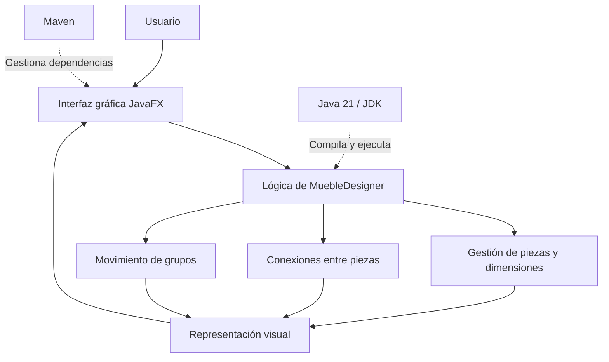

# Maipu_Aldo_Martinez_006D_Tara_Martinez

# MuebleDesigner

Aplicación de escritorio para el diseño y la composición de muebles, desarrollada con Java y JavaFX.

## 1. Descripción del proyecto

**MuebleDesigner** es una aplicación de escritorio orientada al diseño visual y la composición de muebles mediante piezas y componentes que pueden organizarse dentro de un área de trabajo.

El proyecto busca facilitar la creación y organización de estructuras de mobiliario, permitiendo trabajar con dimensiones, conexiones entre piezas, selección de elementos y movimiento de grupos.

Está dirigido a personas interesadas en el diseño de muebles, estudiantes y usuarios que necesiten una herramienta local para experimentar con composiciones de mobiliario.

El objetivo es desarrollar una herramienta que permita visualizar y organizar piezas de manera intuitiva, reduciendo la dificultad de representar estructuras de muebles mediante procedimientos manuales.

> Estado del proyecto: en desarrollo. Las funcionalidades disponibles dependen de la versión actual del código fuente.

## 2. Tecnologías utilizadas

| Tecnología o herramienta | Versión | Uso |
|---|---|---|
| Java | 21 | Lenguaje principal de programación. |
| Eclipse Temurin JDK | 21.0.12.1 | Kit de desarrollo para compilar y ejecutar Java. |
| JavaFX | 21.0.8 | Desarrollo de la interfaz gráfica y representación visual. |
| Apache Maven | Por verificar | Gestión de dependencias y compilación del proyecto. |
| IntelliJ IDEA Community Edition | 2025.2.6.3 | Entorno de desarrollo, ejecución y depuración. |
| Git | Por verificar | Control de versiones, si está configurado en el proyecto. |
| GitHub | Plataforma web | Alojamiento del repositorio y respaldo del código fuente. |

### Base de datos y servicios externos

La versión local actual no requiere una base de datos ni servicios en la nube para su funcionamiento básico previsto.

## 3. Requisitos previos

Antes de ejecutar MuebleDesigner, se necesita:

- Windows, Linux o macOS compatible con Java.
- JDK 21 instalado.
- Apache Maven o el sistema de ejecución Maven configurado en el IDE.
- Git, si se desea clonar el repositorio mediante la terminal.
- Conexión a Internet para descargar el proyecto y resolver dependencias durante la configuración inicial, cuando sea necesario.

Una vez descargadas las dependencias, la aplicación no debería necesitar conexión a Internet para sus funciones locales, siempre que estas no dependan de servicios externos.

## 4. Instalación y ejecución local

### 4.1. Obtener el código fuente

Clonar el repositorio:

```bash
git clone <URL_DEL_REPOSITORIO>
```

Entrar en la carpeta del proyecto:

```bash
cd MuebleDesigner
```

Si ya se dispone del código fuente, se puede abrir directamente la carpeta que contiene el archivo `pom.xml`.

### 4.2. Verificar Java

Abrir una terminal y ejecutar:

```bash
java -version
javac -version
```

Ambos comandos deben permitir comprobar que Java está instalado y que se dispone del compilador. Se debe utilizar JDK 21 para este proyecto.

### 4.3. Verificar Maven

Ejecutar:

```bash
mvn -version
```

Este comando permite comprobar la instalación de Maven y la versión de Java que utiliza.

Si Maven no está disponible como comando global, se puede utilizar el Maven configurado en IntelliJ IDEA o el Maven Wrapper, si está incluido en el repositorio.

### 4.4. Abrir el proyecto en IntelliJ IDEA

1. Abrir IntelliJ IDEA Community Edition.
2. Seleccionar la opción para abrir un proyecto existente.
3. Elegir la carpeta raíz de MuebleDesigner.
4. Comprobar que IntelliJ reconoce el archivo `pom.xml`.
5. Configurar el JDK 21 como SDK del proyecto.
6. Esperar a que Maven descargue y sincronice las dependencias.
7. Revisar que no existan errores de configuración.

### 4.5. Compilar el proyecto

Desde la terminal, ubicada en la carpeta raíz del proyecto, ejecutar:

```bash
mvn clean compile
```

Este comando limpia los archivos generados anteriormente y compila el código fuente.

### 4.6. Ejecutar la aplicación

Si el archivo `pom.xml` incluye la configuración del complemento de JavaFX, se puede ejecutar:

```bash
mvn javafx:run
```

Si el proyecto utiliza otra configuración de ejecución, iniciar la clase principal desde IntelliJ IDEA o seguir las instrucciones definidas en el `pom.xml`.

**Nota:** el comando definitivo de ejecución debe comprobarse con la configuración real del proyecto antes de publicar estas instrucciones como verificadas.

## 5. Estructura del proyecto

La estructura general prevista es la siguiente. Los nombres de las carpetas y paquetes deben ajustarse a los que existan realmente en el repositorio.

```text
MuebleDesigner/
├── src/
│   ├── main/
│   │   ├── java/
│   │   │   └── [paquetes de la aplicación]
│   │   └── resources/
│   │       └── [recursos de la interfaz]
│   └── test/
│       └── java/
├── pom.xml
├── README.md
└── .gitignore
```

- `src/main/java/`: código fuente de la aplicación.
- `src/main/resources/`: recursos utilizados por la interfaz, si corresponde.
- `src/test/java/`: pruebas automatizadas, si están implementadas.
- `pom.xml`: configuración de Maven y dependencias del proyecto.
- `README.md`: documentación principal del repositorio.
- `.gitignore`: archivos y carpetas que no deben incorporarse al control de versiones.

## 6. Funcionalidades del proyecto

MuebleDesigner está orientado a incorporar las siguientes capacidades:

- Representación visual de piezas de mobiliario.
- Definición y manejo de dimensiones.
- Selección y movimiento de elementos dentro del área de trabajo.
- Conexión y organización de piezas.
- Movimiento conjunto de grupos de elementos.
- Interacción con una interfaz gráfica de escritorio.

La disponibilidad de cada funcionalidad debe verificarse en la versión actual del código fuente. Esta lista describe el alcance funcional del proyecto y no implica que todas las características estén terminadas.

## 7. Arquitectura de la solución

MuebleDesigner sigue un enfoque de aplicación de escritorio. Java se utiliza para implementar la lógica del programa, JavaFX para presentar la interfaz gráfica y Maven para gestionar la configuración y las dependencias.

El diseño busca separar, en la medida en que lo permita la estructura actual del código, la representación visual de las piezas y las reglas que controlan sus dimensiones, conexiones y movimientos.

### Diagrama general



El diagrama representa la organización funcional prevista y no necesariamente los paquetes o clases exactos del código actual.

### Componentes principales

- **Interfaz gráfica:** permite al usuario interactuar con el área de trabajo y los controles de la aplicación.
- **Lógica de diseño:** administra las operaciones sobre las piezas, sus dimensiones, las conexiones y los grupos.
- **Representación visual:** muestra los elementos y actualiza su apariencia cuando cambia la composición.
- **Gestión del proyecto:** Maven administra las dependencias y la compilación, mientras que Java proporciona el entorno de ejecución.

La versión local no contempla una base de datos como requisito para su funcionamiento básico previsto.

## 8. Integrantes y roles

| Integrante | Rol | Responsabilidades |
|---|---|---|
| [Paris Martínez] | Desarrollo de software | Implementación, mantenimiento, pruebas y documentación del proyecto. |
| [Maximiliano Tara] | Gestión del Proyecto | Organización del proyecto, documentación del proyecto y respaldo en GitHub. |

## 9. Metodología de trabajo

El desarrollo se organiza mediante un enfoque iterativo e incremental, avanzando progresivamente desde la configuración del entorno hasta la implementación y validación de las funcionalidades.

Las actividades de trabajo pueden organizarse en las siguientes etapas:

1. Preparación del entorno de desarrollo y configuración del proyecto.
2. Implementación de la interfaz gráfica y del área de trabajo.
3. Desarrollo de la lógica para administrar piezas, dimensiones y conexiones.
4. Incorporación de operaciones de selección, movimiento y agrupación.
5. Pruebas, corrección de errores y mejoras de usabilidad.
6. Actualización de la documentación y respaldo del código en GitHub.

El control de versiones permite mantener un historial de los cambios y disponer de una copia remota del código fuente.

## 10. Control de versiones y buenas prácticas

El código fuente se mantiene en un repositorio Git alojado en GitHub.

Antes de publicar cambios, se recomienda:

- Verificar que el proyecto compile correctamente.
- Revisar las modificaciones realizadas.
- Excluir archivos temporales, directorios generados y configuraciones personales.
- No subir contraseñas, tokens, claves privadas ni otras credenciales.
- Mantener actualizado el archivo `README.md`.
- Registrar los cambios mediante mensajes de confirmación descriptivos.

Los archivos generados durante la compilación, como `target/`, normalmente deben excluirse del repositorio.

## 11. Estado actual y trabajo futuro

MuebleDesigner se encuentra en desarrollo. Las próximas mejoras dependerán de las funcionalidades pendientes y de los resultados de las pruebas.

Entre las posibles líneas de evolución se encuentran:

- Mejorar la precisión y facilidad de manipulación de las piezas.
- Consolidar las reglas de conexión y movimiento conjunto.
- Mejorar la experiencia de uso de la interfaz.
- Ampliar las pruebas y la documentación técnica.
- Preparar una versión ejecutable que facilite la instalación y distribución.

Estas líneas representan posibles mejoras y no funcionalidades garantizadas de la versión actual.

## 12. Licencia

La licencia del proyecto hasta entonces, no se presupone que el código esté publicado bajo una licencia de código abierto.

---

**MuebleDesigner** — Proyecto de desarrollo de software para el diseño y la composición visual de muebles.
